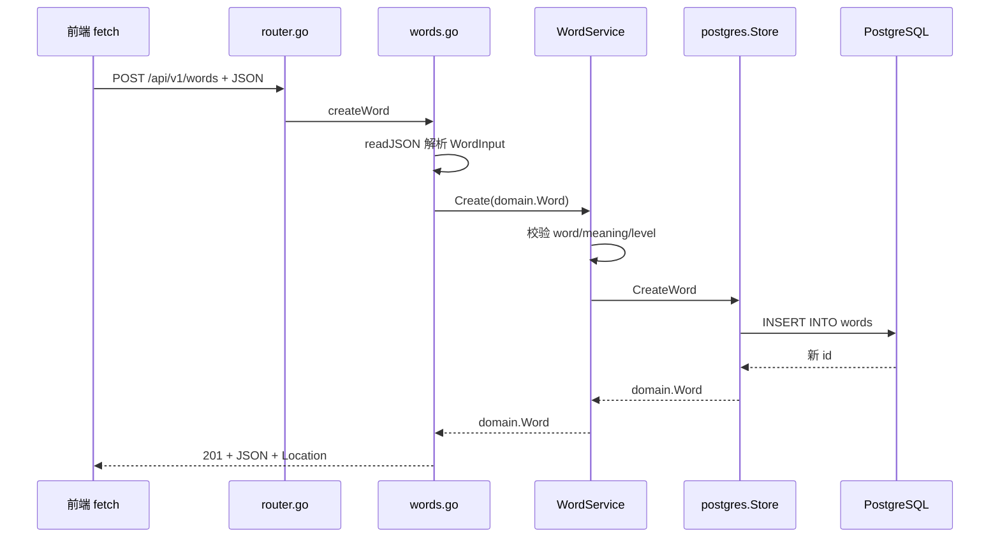

# 前端开发者上手指南

这是一个 Go 后端项目，没有前端页面。浏览器里能打开的 `/docs` 是 Swagger UI，用来直接调接口；真正的业务数据在 PostgreSQL 里。

如果你只想先跑通，按下面三步做；想理解代码，从第 2 节开始看。

## 1. 先跑起来

在项目根目录：

```bash
docker compose up -d --wait   # 启动 PostgreSQL，宿主端口 5433
go run ./cmd/seed             # 导入 3,849 个 CET-4 词汇
go run ./cmd/api              # 启动 API，监听 8080
```

然后打开：

- 接口文档：<http://localhost:8080/docs>
- OpenAPI 3.0：<http://localhost:8080/openapi.json>
- 健康检查：<http://localhost:8080/healthz>

Swagger UI 里展开任意接口，点 **Try it out** 就能直接发请求，不需要写前端。

## 2. 用前端概念理解目录

| 前端里的东西 | 这个项目里的位置 | 说明 |
|---|---|---|
| 页面/组件 | `internal/httpapi/words.go`、`tests.go` | 每个函数就是一个接口入口 |
| 路由表 | `internal/httpapi/router.go` | 方法 + 路径 → handler |
| 表单字段 / 响应 JSON | `internal/httpapi/dto.go` | 请求体、响应体的结构 |
| 前端类型定义 | `internal/domain/word.go`、`test.go` | 后端业务对象、纯规则和 JSON 形状 |
| 表单校验 / 业务规则 | `internal/domain/` + `internal/service/` | 纯规则在 domain，例如 level 1–5；需要查库的规则在 service/repository，例如答案覆盖 |
| 接口请求 / 数据访问 | `internal/repository/postgres/` | 真正执行 SQL 的地方 |
| 启动和依赖装配 | `cmd/api/main.go` | 建连接池、装配 service、启动 HTTP |
| 种子数据 | `internal/seed/` | 内嵌的 CET-4 CSV |
| 测试 | `internal/integration/api_test.go` | 从 HTTP 层跑完整流程 |

依赖方向是单向的：

```text
httpapi → service → domain
              ↓
       repository/postgres
```

`httpapi` 不直接写 SQL，`repository` 也不处理 HTTP 状态码。这样改 JSON 字段和改 SQL 不会互相污染。

## 3. 一个请求怎么走

以 `POST /api/v1/words` 为例：



对应的代码位置：

1. 路由：`internal/httpapi/router.go`
2. handler：`internal/httpapi/words.go`
3. 请求体：`internal/httpapi/dto.go` 的 `WordInput`
4. 业务校验：`internal/domain/word.go` 的 `NewWord` / `Normalize`；service 负责调用
5. SQL：`internal/repository/postgres/store.go` 的 `CreateWord`
6. 数据结构：`internal/domain/word.go` 的 `Word`

## 4. 页面动作和 API 对照

| 前端动作 | 方法 + 路径 | 请求体 | 成功响应 |
|---|---|---|---|
| 词库列表 | `GET /api/v1/words?level=1&limit=20&offset=0` | 无 | `{ items, total }` |
| 新增词汇 | `POST /api/v1/words` | `{ word, meaning, level }` | 201 + 词汇 |
| 编辑词汇 | `PUT /api/v1/words/{id}` | `{ word, meaning, level }` | 200 + 词汇 |
| 局部编辑 | `PATCH /api/v1/words/{id}` | 至少一个字段 | 200 + 词汇 |
| 删除词汇 | `DELETE /api/v1/words/{id}` | 无 | 204 |
| 开始测试 | `POST /api/v1/tests` | `{ count }`，可省略 | 201 + 题目 |
| 查询测试 | `GET /api/v1/tests/{id}` | 无 | 200 + 题目/结果 |
| 提交答案 | `POST /api/v1/tests/{id}/answers` | `{ answers }` | 200 + 分数 |

几个约定：

- `level` 是 1–5，1 最常用，5 最生僻。
- `POST /api/v1/tests` 的 `count` 默认 20，最大 100；每个题目返回 4 个选项，但不会返回正确答案下标。
- 提交答案时，`answers` 必须覆盖全部题目，`word_id` 不能重复，`selected_index` 是 0–3。
- 删除一个已经被测试引用过的词会返回 409；这是当前的产品规则。

## 5. 在前端代码里调用

先写一个小的请求封装：

```js
async function api(path, options = {}) {
  const response = await fetch(path, options);
  const body = await response.json();
  if (!response.ok) {
    throw new Error(body.error ?? response.statusText);
  }
  return body;
}
```

### 词库列表

```js
const { items, total } = await api("/api/v1/words?level=1&limit=20");
console.log(total, items);
```

### 新增词汇

```js
const word = await api("/api/v1/words", {
  method: "POST",
  headers: { "Content-Type": "application/json" },
  body: JSON.stringify({
    word: "abandon",
    meaning: "v. 放弃；抛弃",
    level: 1,
  }),
});
```

### 创建测试

```js
const test = await api("/api/v1/tests", {
  method: "POST",
  headers: { "Content-Type": "application/json" },
  body: JSON.stringify({ count: 5 }),
});

// test.questions 里每一项长这样：
// { word_id: 1, word: "abandon", options: ["...", "...", "...", "..."] }
```

### 提交答案

```js
const answers = test.questions.map((question) => ({
  word_id: question.word_id,
  selected_index: 0, // 0–3，对应 options 的下标
}));

const result = await api(`/api/v1/tests/${test.id}/answers`, {
  method: "POST",
  headers: { "Content-Type": "application/json" },
  body: JSON.stringify({ answers }),
});

console.log(result.correct_count, result.estimated_vocabulary);
```

## 6. JSON 字段在哪定义

| JSON 字段 | 定义位置 |
|---|---|
| 词汇的 `id/word/meaning/level` | `internal/domain/word.go` |
| 新增/全量更新的请求体 | `internal/httpapi/dto.go` 的 `WordInput` |
| 局部更新的请求体 | `internal/httpapi/dto.go` 的 `WordPatchInput` |
| 列表响应 | `internal/httpapi/dto.go` 的 `WordListResponse` |
| 测试的 `questions/result` | `internal/domain/test.go` |
| 创建测试的请求体 | `internal/httpapi/dto.go` 的 `CreateTestRequest` |
| 提交答案的请求体 | `internal/httpapi/dto.go` 的 `SubmitAnswersRequest` |
| 统一错误体 | `internal/httpapi/dto.go` 的 `ErrorResponse` |

## 7. 改一个字段要动哪些文件

假设要给词汇加一个 `phonetic`（音标）字段：

1. `internal/repository/postgres/schema.go`：加列和 `COMMENT ON COLUMN`。
2. `internal/domain/word.go`：加字段、`json` tag、Swagger `example`；如果字段有纯规则，也加在这里。
3. `internal/httpapi/dto.go`：如果请求或响应需要它，同步改 DTO。
4. `internal/service/word.go`：如果校验需要查库或编排，加在这里。
5. `internal/repository/postgres/store.go`：所有 `INSERT/UPDATE/SELECT` 补列。
6. `internal/httpapi/words.go`：Swagger 注解和示例补字段。
7. `internal/integration/api_test.go`：补创建、查询、更新的断言。
8. 执行 `go generate ./...`，再重启 API。

注意：`schema.go` 用的是 `CREATE TABLE IF NOT EXISTS`，已经存在的表不会自动加列。给现有数据库加字段时，要写 `ALTER TABLE ... ADD COLUMN IF NOT EXISTS`，或者手动在 DBeaver 里执行。

## 8. 前端另起端口时的 CORS

API 没有开启 CORS。如果前端跑在 `localhost:5173`，直接 `fetch("http://localhost:8080/...")` 会被浏览器拦。

最简单的做法是用 Vite 代理，把同源请求转发到 8080：

```js
// vite.config.js
export default {
  server: {
    proxy: {
      "/api": "http://localhost:8080",
      "/healthz": "http://localhost:8080",
    },
  },
};
```

这样前端代码里继续写 `fetch("/api/v1/words")` 就行，不需要改后端。

## 9. 代码地图

建议按这个顺序读：

1. `internal/httpapi/router.go`：先看有哪些接口。
2. `internal/httpapi/words.go`、`tests.go`：每个接口怎么解析请求。
3. `internal/httpapi/dto.go`：请求和响应的 JSON 长什么样。
4. `internal/domain/word.go`、`test.go`：纯规则和数据形状。
5. `internal/service/word.go`、`test.go`：用例编排。
6. `internal/repository/postgres/store.go`：SQL 和事务。
7. `cmd/api/main.go`：这些层怎么被装起来。

不需要先看：

- `internal/httpapi/docs/`：自动生成的 Swagger/OpenAPI 文件。
- `cmd/openapi3/`：把 Swagger 2.0 转成 OpenAPI 3.0 的工具。
- `internal/seed/`：只在导入词库时用。

## 10. 术语表

| 术语 | 在这个项目里的意思 |
|---|---|
| handler | 一个 HTTP 接口的入口函数，负责解析请求、调用 service、写响应 |
| service | 用例编排；纯规则在 domain，SQL 在 repository |
| repository | 数据访问层，负责 SQL、事务和依赖数据库状态的规则 |
| domain | 业务对象、纯规则和纯计算 |
| DTO | 专用于 HTTP 请求/响应的结构 |
| seed | 初始化数据，这里是 CET-4 词表 |
| Swagger / OpenAPI | 接口文档格式；`/docs` 是 Swagger UI |
| integration test | 从 HTTP 层起完整跑一遍的测试 |

## 11. 常见问题

- **端口 5433 被占用**：本项目把容器 5432 映射到宿主 5433，避免和你本机或其他项目的 PostgreSQL 冲突。
- **测试库**：集成测试用 `vocab_test`，会清空这张库的表，不要指向 `vocab`。
- **改了注解但文档没变**：执行 `go generate ./...`，再重启 API；文档是编译时嵌进二进制的。
- **`/docs` 页面空白**：Swagger UI 的 CSS/JS 从 unpkg CDN 加载，断网时只能直接访问 `/openapi.json`。
- **删除词汇返回 409**：这个词已经被某次测试引用；当前规则不允许删除。

## 12. 可直接运行的请求

`docs/requests.http` 里有列表、新增、更新、删除、建测试、提交答案的完整请求，VS Code 装 REST Client 或 JetBrains 用 HTTP Client 就能点运行。
